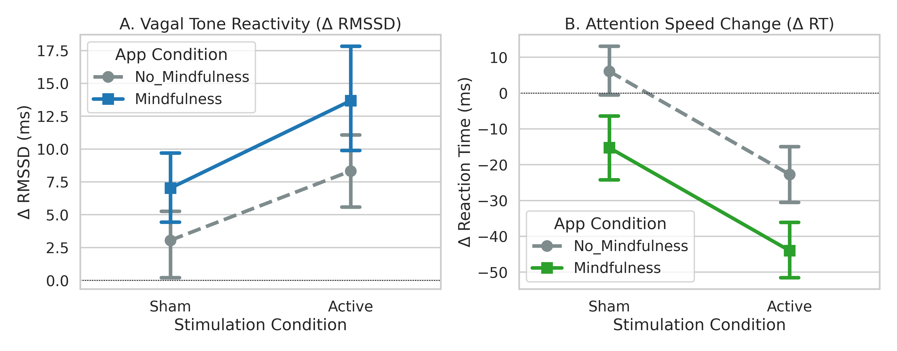
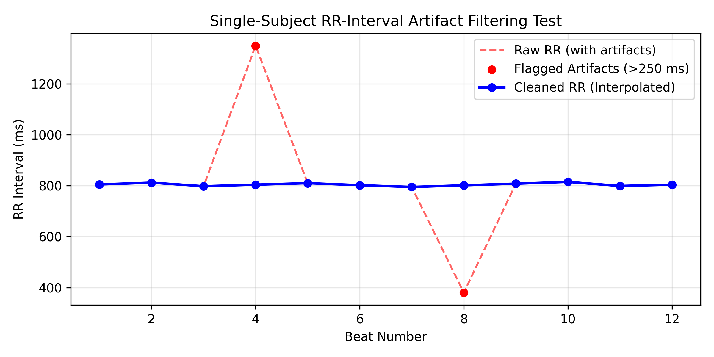

# taVNS & Mindfulness: 2 × 2 Factorial HRV & Attention Pipeline

A reproducible Python pipeline simulating and analyzing physiological (heart rate variability) and behavioral (reaction time) outcomes across a **2 × 2 factorial design** (`Stimulation`: Active vs. Sham taVNS × `App Condition`: Mindfulness vs. No Mindfulness, *N* = 40).

#### Plain-English Overview: What This Project Does & What I Learned

#### What I’m Doing

In this project, I built an automated data-cleaning and analysis pipeline to test how two different interventions—**ear-based nerve stimulation (taVNS)** and **mindfulness meditation**—affect stress recovery and focus, both separately and together. Because raw heart rate data is notoriously messy, the code acts like a digital filter that spots and cleans up sensor glitches before running statistical tests to see if these interventions actually calm the nervous system (measured by heart rate variability) and sharpen attention (measured by reaction times). 

#### What I Learned

* **Clean data matters more than fancy math:** Physiological signals are full of tiny hiccups (like a participant moving or a sensor slipping). Building an automated quality-control rule (dropping sessions with more than 5% bad data) showed me how small recording errors can completely skew results if you don't catch them early.
* **Testing pipelines with fake data saves headaches:** Generating a realistic, simulated dataset first allowed me to verify that my cleaning filters and statistical models worked properly before ever touching real human data.
* **Bridging biology and behavior:** Translating raw heartbeat intervals into meaningful psychological metrics (like vagal tone) gave me hands-on experience connecting nervous system activity directly to cognitive performance.
  
## Repository Contents

* `analysis/artifact_filter_validation.ipynb` — Standalone validation notebook testing the 5-beat rolling-median threshold filter and linear interpolation on synthetic RR artifacts.
* `artifact_cleaning_example.png` — Diagnostic plot showing raw sensor spikes vs. interpolated RR intervals.

* `experiment/` — Experimental paradigm design and task parameters.
* `analysis/hrv_2x2_anova.ipynb` — Jupyter/Colab notebook for Kubios-style RR-interval artifact filtering, HRV feature extraction (`RMSSD`, `SDNN`, `pNN50`, `LF/HF`), automated quality control (`<= 5%` artifact cutoff), and Type II 2 × 2 ANOVA.
* `synthetic_2x2_hrv.csv` — Simulated cohort dataset (*n* = 10 per cell).
* `tavns_mindfulness_2x2_results.png` — Two-panel interaction plot showing vagal tone reactivity (Δ RMSSD) and attention speed changes (Δ RT).

## Results Preview

*Figure 1: Group-level interaction effects across Active vs. Sham taVNS and Mindfulness conditions (N = 40).*

*Figure 2: Single-subject validation of the 5-beat rolling-median threshold filter (>250 ms cutoff) and linear interpolation.*

## Limitations & Future Directions

* **Synthetic Data Assumptions:** The current dataset (`N = 40`, `n = 10` per cell) is synthetically generated under controlled parametric assumptions (e.g., normal error distributions and predefined effect sizes) to validate the preprocessing and statistical pipeline. Real-world psychophysiological recordings typically exhibit greater inter-individual baseline variability and non-normal artifact bursts.
* **Simulated vs. Raw ECG/PPG Waveforms:** Preprocessing currently operates on simulated RR-interval series rather than raw electrocardiography (ECG) or photoplethysmography (PPG) signals. Future iterations will incorporate raw waveform peak detection (e.g., NeuroKit2 or MNE-Python) and real-time respiration rate control, as respiratory sinus arrhythmia (RSA) can confound vagally mediated HRV metrics like RMSSD.
* **Statistical Power & Longitudinal Dynamics:** A sample size of `n = 10` per condition provides adequate power only for large interaction effects and does not capture within-session temporal dynamics. Expanding the pipeline to handle mixed-effects models (LME) across multi-block time windows will allow finer tracking of autonomic habituation and sustained attention.
* **Stimulation Parameter Blinding:** In empirical taVNS protocols, sensory perception differences between active cymba conchae stimulation and earlobe sham can affect participant blinding. Future experimental modules will log perceptual rating scales as covariates in the behavioral and autonomic models.
